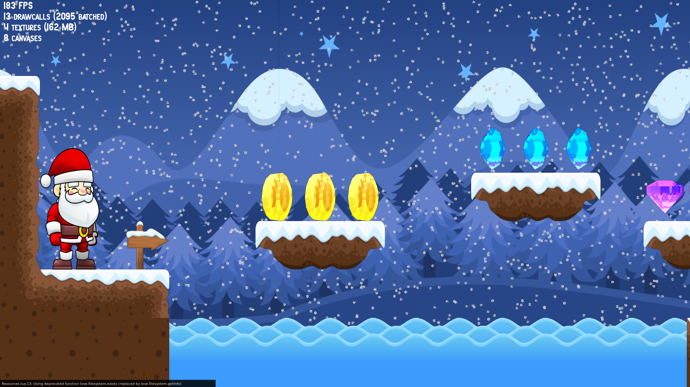

# Papá Noel 🎅

[](https://github.com/bkuolt/papa-noel/actions/workflows/test.yml)
[](https://love2d.org)

*Papá Noel* ("Santa Claus" in Spanish) is a prototype for a 2D platformer game built with the [LÖVE2D](https://love2d.org) engine in Lua.



---

## 🚀 Quick Start

### 1. Installation & Dependencies

Clone the repository and install system dependencies:

```bash
git clone https://github.com/bkuolt/papa-noel.git
cd papa-noel
task install-deps
```

*Alternatively, run `./install.sh` directly on Debian/Ubuntu systems.*

### 2. Running the Game

Launch the application via Taskfile:

```bash
task run
```

*Alternatively, execute `./papa-noel` directly from the terminal.*

---

## 🎮 Controls

| Key / Action | Function |
| :--- | :--- |
| <kbd>Esc</kbd> | Save level state and exit game |
| <kbd>P</kbd> | Pause / resume game |
| <kbd>B</kbd> | Toggle bounding box debug rendering |
| <kbd>Space</kbd> | Toggle Level Editor mode |
| <kbd>Left</kbd> / <kbd>Right</kbd> / <kbd>Up</kbd> / <kbd>Down</kbd> | Scroll viewport camera |
| <kbd>Mouse Left Click</kbd> | Place or cycle tile image (in Editor Mode) |
| <kbd>Mouse Right Click</kbd> | Remove tile (in Editor Mode) |

---

## 🛠️ Project Architecture

- `source/main.lua` - Main application lifecycle and Love2D event callbacks
- `source/Level.lua` - World rendering, entity updates, and background scrolling
- `source/LevelEditor.lua` - Interactive level editing tools and input handling
- `source/GameObject.lua` - Base class for scene objects with collision bounding boxes
- `source/Resources.lua` - Asset management for textures, animations, and tilemaps
- `source/SaveGame.lua` - Level serialization and world persistence (`world.data`)

---

## 📜 License

Distributed under the MIT License. See `LICENSE` for details.